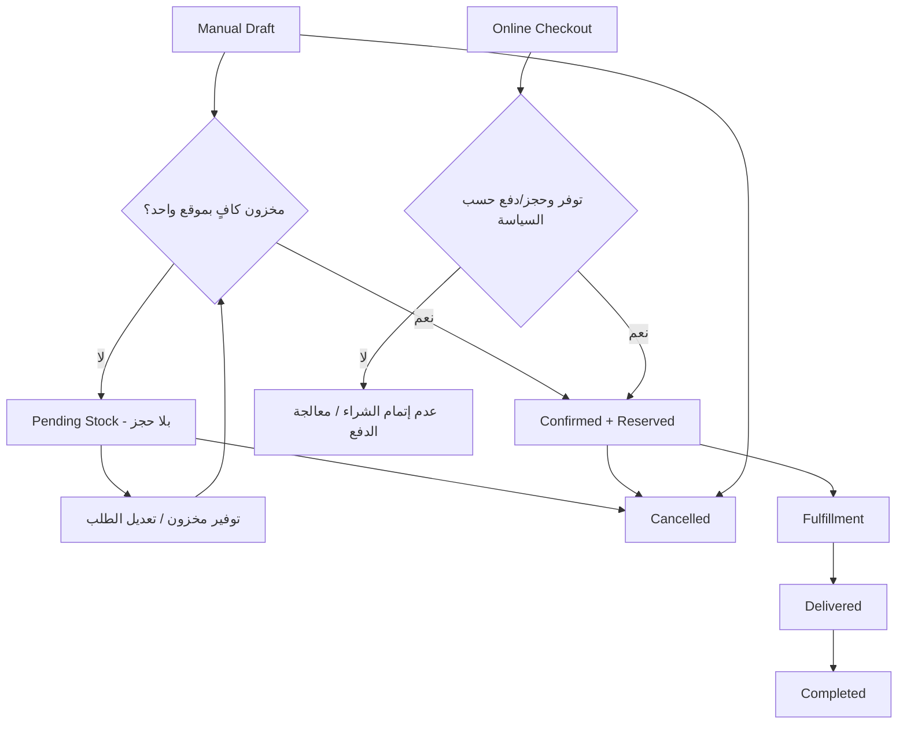
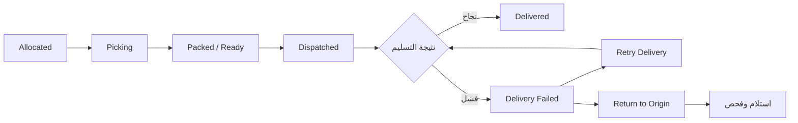

# وثيقة تسليم وتحليل مشروع منصة التجارة الإلكترونية SaaS

**اسم المشروع المؤقت:** Multi-Tenant E-commerce SaaS — Unified Commerce Operations  
**نوع الوثيقة:** Business Discovery & Requirements Handoff (وثيقة تجميع وتحليل النقاشات)  
**الإصدار:** `0.1 — Discussion Consolidation`  
**تاريخ التوثيق:** 11 نوفمبر 2026  
**لغة الوثيقة:** العربية مع المصطلحات الإنجليزية المتخصصة  
**الجمهور المستهدف:** شريك العمل، محلل النظم، مدير المنتج، مصمم التجربة، ومهندسو البرمجيات  
**الحالة:** **وثيقة عمل مبدئية وليست مواصفات نهائية معتمدة**

> **اقرأ هذا أولًا:** هذه الوثيقة تجمع ما دار في المناقشة من البداية حتى آخر رسالة. يوجد فرق صريح بين **قرار اختاره صاحب المشروع**، و**ترشيح أو سياسة مقترحة من المحلل**، و**سؤال لم يُحسم**. لا يجوز اعتبار الترشيحات أو الأمثلة الرقمية متطلبات نهائية، ولا البدء في تصميم معماري استنادًا إليها قبل اعتمادها.

---

## 0. كيفية استخدام الوثيقة

### وسوم حالة القرارات

| الوسم | المعنى | طريقة التعامل |
|---|---|---|
| **[متفق عليه]** | اختيار أو قرار صريح اتُّخذ أثناء الحوار | يُعامل كمدخل ثابت نسبيًا لحين مراجعته |
| **[مقترح]** | ترشيح تحليلي طُرح، لكنه لم يحصل على اعتماد صريح | يُناقَش قبل التحويل إلى قاعدة نهائية |
| **[مفتوح]** | سؤال لم يُجب عنه بعد أو جانب يحتاج تفاصيل إضافية | لا يجوز افتراض إجابته |
| **[مؤجل]** | وظيفة تم اقتراح تأجيلها أو وضعها خارج MVP | ليس التزامًا نهائيًا بخارطة طريق أو موعد |

**حدود هذه الوثيقة:** تحليل نموذج العمل وقواعد التشغيل ورحلات الاستخدام. **لا تتضمن قرارات تنفيذية نهائية** حول بنية قواعد البيانات، أو أسلوب عزل الـ Tenants، أو تقسيم خدمات الـ Backend، أو APIs، أو الواجهات البرمجية، أو الحزم المستخدمة.

### التسليم المختصر للشريك

المشروع منصة **SaaS متعددة التجار/المستأجرين (Multi-Tenant)** لإنشاء متجر مستقل لكل تاجر وإدارة مبيعاته وطلباته ومخزونه. تستهدف **التجار الصغار والمتوسطين في مصر والخليج**. لا تقتصر على الطلبات الإلكترونية، بل تدعم **Online Orders وManual Orders وDirect Sales** مع مخزون موحد الرؤية لكن **منفصل لكل موقع** (محل أو مخزن). تُخصَّص الطلبات **حسب أولوية المواقع وقدرة الموقع الواحد على تنفيذ الطلب كله**. لا يوجد **Split Fulfillment** في الإصدار الأول المقترح. الطلب اليدوي الناقص يمكن تسجيله **Pending Stock بدون تأكيد أو حجز**. آخر نقطة في الحوار لم تُحسم: **هل يُسمح بتعديل منتجات وكميات الطلب المؤكد أثناء Picking/Packing وحتى قبل Dispatch، أم يُغلق التعديل بمجرد بدء Picking؟**

---

# الجزء الأول: خلفية المشروع والاتجاه العام

## 1. الفكرة الأساسية

بناء منتج تجاري قابل للاشتراك فيه، يستطيع من خلاله التاجر إنشاء متجر إلكتروني مستقل وتشغيله وإدارة مبيعاته وطلباته وكميات منتجاته من لوحة واحدة، بما فيها المبيعات التي تتم خارج المتجر الإلكتروني.

### 1.1 الأطراف الأساسية

| الطرف | دوره | أمثلة لما يحتاجه |
|---|---|---|
| **Platform Owner / SaaS Operator** | الشركة المالكة للمنصة | إدارة التجار والمتاجر، الباقات، الاشتراكات، حالة الحسابات، الدعم والإشراف |
| **Merchant / Tenant** | الشركة أو التاجر المشترك في المنصة | إنشاء متجر وإدارة المنتجات والمواقع والمخزون والموظفين والطلبات والمبيعات |
| **Merchant Staff** | العاملون لدى التاجر | استقبال الطلبات اليدوية، البيع المباشر، تجهيز الطلبات، الجرد، تحويل البضاعة، المرتجعات وفق الصلاحية |
| **Shopper / End Customer** | عميل يشتري من متجر تاجر محدد | تصفح المنتجات، إتمام الطلب، اختيار التسليم، الدفع، متابعة الطلب، طلب إرجاع |
| **Shipping / Payment Partners** | جهات خارجية تتعاون مع التاجر/المنصة | التحصيل والشحن والتسليم ورد الأموال؛ تفاصيل التكاملات لم تُحسم |

### 1.2 ماذا يعني Multi-Tenant هنا؟ **[متفق عليه من حيث نموذج العمل]**

- المنصة تستضيف عدة تجار، ولكل تاجر متجره وعملياته وبياناته التجارية المستقلة.
- لا نفترض وجود Marketplace تجمع منتجات كل التجار في واجهة بيع واحدة؛ **المقصود متاجر مستقلة**.
- هناك ثلاث طبقات فصل مطلوب مراعاتها عند التخطيط لاحقًا: **فصل الأعمال** بين التجار، **فصل البيانات** وحماية الخصوصية، و**العزل التشغيلي** بحيث لا تؤثر أعباء تاجر على بقية التجار بشكل غير مقبول.
- **لم يُتخذ قرار** بشأن Shared Database أو Database per Tenant أو أي نموذج تقني آخر.

### 1.3 السوق والجمهور والنطاق **[متفق عليه]**

| البند | الاختيار |
|---|---|
| الأسواق المستهدفة | **مصر والخليج** |
| حجم العملاء المستهدفين | **تجار صغار ومتوسطون (SMBs)** |
| المنتج | **متجر إلكتروني + إدارة طلبات + إدارة مخزون** |
| نموذج التشغيل | **Unified Commerce Operations** |
| قنوات البيع | **Online + Manual Orders + Direct Sales** |

### 1.4 المعنى التجاري لاختيار مصر والخليج

يوجد اختلاف محتمل بين الدول في وسائل الدفع، والتحصيل عند الاستلام، وشركات الشحن، والعملات، والضرائب والفواتير، والتعامل مع العناوين والتوصيل. لا يجب التعامل مع «الخليج» كوحدة قانونية أو تشغيلية واحدة؛ التشريعات والتكاملات تختلف حسب الدولة.

**[مقترح]** اختيار دولة إطلاق واحدة (Launch Market) بدل إطلاق متزامن بجميع الدول، مع تصميم المنتج تجاريًا ليقبل التوسع لاحقًا. **لم تُحدد دولة البداية ولا الترتيب الزمني للتوسع**.

### 1.5 شخصية العميل المستهدف

**التاجر الصغير:** يحتاج إنشاء متجر بسرعة، إدخال منتجات، استقبال الطلبات، التحكم في أسعار وكميات، وواجهة سهلة قليلة الخطوات. قد يبيع من واتساب وإنستجرام والمحل في نفس الوقت.

**التاجر المتوسط:** يحتاج أكثر من موقع تخزين/بيع، موظفين وصلاحيات، إدارة طلبات أكثر، متابعة دقيقة للكميات والمرتجعات، وتقارير أفضل. قد تتفاوت حاجة التجار المتوسطين للعمليات المحاسبية المتقدمة والـ POS.

**المبدأ المقترح لتجربة المنتج:** **Simple to Start, Powerful as You Grow** — لا نحول الـ MVP إلى ERP ضخم، ولا نحرم التاجر المتنامي من قواعد تشغيل سليمة.

---

## 2. الاتجاه التقني ومنهج العمل (للتوثيق فقط، دون اعتماد معماري)

### 2.1 الـ Technology Stack الذي حدده صاحب المشروع **[متفق عليه كاتجاه]**

- **Laravel** للـ Backend.
- **PostgreSQL** لقاعدة البيانات.
- **Next.js** للـ Frontend.
- **GitHub Spec Kit / Specification-Driven Development** لتنظيم التحليل والتخطيط والتنفيذ.

**مهم:** اختيار هذه التقنيات **لا يعني** اتخاذ قرارات نهائية حول الإصدار، هيكل الموديولات، أسلوب الـ Multi-Tenancy، الـ Auth، تقسيم تطبيقات Next.js، الـ Deployment، أو قواعد التخزين الداخلية.

### 2.2 مرجعية «مشروع طَبعة»

طلب صاحب المشروع الاستفادة من أسلوب العمل في مشروع **طَبعة**، وليس نسخ بنيته بلا مراجعة. وردت أثناء الحوار أفكار للاستفادة منها، مثل:

- الفصل بين Business Logic والواجهات.
- التنظيم بالموديولات وحدود المسؤوليات.
- صلاحيات واضحة للمستخدمين.
- توثيق قواعد الأعمال واختبارها.
- إبقاء التوثيق الأساسي للمشروع مستقلًا عن ملفات Spec Kit الناتجة لكل Feature.
- تبني **Lightweight Spec-Driven Development** بدل إدخال تعقيد تقني لا يحتاجه المشروع.

> **تنبيه مصدر:** لم تُقدَّم في هذه المحادثة ملفات مشروع «طَبعة» أو مستودعه للتحقق منها. هذه النقاط تنقل **ما ورد في النقاش عنه**؛ وليست نتيجة فحص مستقل للملفات.

### 2.3 المنهجية المتفق على اتباعها

1. **Constitution:** مبادئ المشروع ومعايير الجودة.
2. **Specify:** متطلبات وBusiness Rules لكل Feature.
3. **Clarify:** إزالة الغموض والتناقضات.
4. **Plan:** وضع الخطة التقنية **بعد** اعتماد متطلبات الميزة.
5. **Tasks:** تقسيم تنفيذ الميزة إلى مهام واضحة.
6. **Analyze:** اختبار اتساق المواصفات والخطة والمهام.
7. **Implement:** التنفيذ والاختبار والمراجعة.

**[مقترح لم يُعتمد]** Modular Monolith للـ Laravel، مع إمكان فصل Storefront وAdmin في Next.js؛ ظل ذلك تصورًا أوليًا لا قرارًا. هذه الوثيقة **لا تعتمده**.

---

# الجزء الثاني: التسلسل الزمني للقرارات

## 3. Decision Log — ماذا اختار صاحب المشروع فعلًا؟

| ID | الموضوع | القرار الصريح | الحالة |
|---|---|---|---|
| D-001 | نموذج المنصة | **Multi-Tenant E-commerce SaaS** | [متفق عليه] |
| D-002 | السوق | **مصر والخليج** | [متفق عليه] |
| D-003 | الشريحة | **تجار صغار ومتوسطون** | [متفق عليه] |
| D-004 | المنتج الأساسي | **متجر + إدارة الطلبات والمخزون** | [متفق عليه] |
| D-005 | نطاق التجارة | **Unified Commerce Operations** بدل Online Store Only أو Full POS/ERP | [متفق عليه] |
| D-006 | العمليات الخارجية | دعم **Manual Orders وDirect Sales** بحسب طبيعة البيع | [متفق عليه] |
| D-007 | المواقع | **مخزون مستقل لكل Location** | [متفق عليه] |
| D-008 | سياسة اختيار موقع التنفيذ | **Priority-Based Allocation** | [متفق عليه] |
| D-009 | الطلب غير المتوفر | السماح بـ **Pending Stock للطلبات اليدوية فقط**؛ بلا تأكيد ولا حجز | [متفق عليه] |
| D-010 | توقيت إيقاف تعديل المنتجات والكميات | الاختيار بين **A: قبل Picking** و**B: حتى قبل Dispatch** | **[مفتوح — لم يجب صاحب المشروع]** |

### 3.1 ترشيحات ظهرت في المناقشة ولم تُحسم بصورة نهائية

| ID | السياسة/الحد | الترشيح المطروح | الحالة |
|---|---|---|---|
| P-001 | نموذج الإيرادات | اشتراكات شهرية/سنوية مبدئيًا، والباقات حسب قيمة الاستخدام | [مقترح] |
| P-002 | تعريف المواقع | محلات ومخازن مع خصائص مستقلة للبيع/التجهيز/الاستلام | [مقترح] |
| P-003 | تنفيذ الطلب | **موقع واحد ينفذ كامل الطلب** داخل MVP | [مقترح قوي ومتكرر؛ ليس اختيارًا منفصلًا صريحًا] |
| P-004 | Split Fulfillment | تأجيل تقسيم الطلب على عدة مواقع | [مقترح/مؤجل] |
| P-005 | حجز Online COD | عند قبول الطلب | [مقترح] |
| P-006 | حجز Online Prepaid | حجز مؤقت أثناء الدفع ثم تثبيت بعد نجاحه | [مقترح] |
| P-007 | حجز Manual | عند تأكيد الموظف | [مقترح] |
| P-008 | Direct Sale | دفع وتسليم فوري، وخصم فوري بدون حجز منفصل | [مقترح] |
| P-009 | الصرف الفعلي | خصم On-hand عند Dispatch أو تسليم البضاعة مباشرة | [مقترح] |
| P-010 | تحويلات المواقع | إرسال ثم استلام، مع مخزون قيد النقل | [مقترح] |
| P-011 | المرتجعات | إعادة الإتاحة بعد الاستلام والفحص، في موقع الاستلام الفعلي | [مقترح] |
| P-012 | تعديل مؤكد | رفض التعديل الفاشل مع الاحتفاظ بالحجز والطلب الأصليين | [مقترح] |
| P-013 | Pending Stock | تأجيل العربون وعدم التحويل التلقائي إلى Confirmed | [مقترح] |
| P-014 | حالة Order | إبقاؤها مستقلة عن Fulfillment وPayment وReturn | [مقترح منهجي أساسي] |

**ملاحظة:** يمكن للفريق استخدام الـ P-items كفرضيات عمل وكتابة سيناريوهات لها، **لكن لا يستخدمها كقرارات نهائية قبل مراجعتها**.

---

# الجزء الثالث: المجالات التجارية الرئيسية (Business Domains)

## 4. خريطة المجالات دون افتراض تصميم تقني

| المجال | الغرض التجاري | مستوى النقاش الحالي |
|---|---|---|
| Platform & Merchant Management | إدارة التجار ومتاجرهم وحساباتهم | تصور عام فقط |
| SaaS Plans & Subscriptions | الإيرادات والباقات والتجديد والتعليق | تصور أولي فقط |
| Storefront & Checkout | تصفح المنتجات والسلة وطلب الشراء | تصور عام + سياسات توفر وحجز مقترحة |
| Catalog & Variants | المنتجات والخصائص والمقاسات والألوان | مبادئ مخزنية، تفاصيل الكتالوج غير محللة |
| Locations | المحلات والمخازن وقدراتها | تحليل جيد، وبعض السياسات مقترحة |
| Inventory | On-hand / Reserved / Available / Adjustments | تحليل تفصيلي مبدئي |
| Allocation | تخصيص الطلب لموقع مناسب | Priority-Based متفق عليه، تفاصيل الأهلية مقترحة |
| Orders | Online / Manual / Direct وOrder Lifecycle | تحليل تفصيلي مبدئي |
| Fulfillment | Picking / Packing / Dispatch / Delivery | تحليل تفصيلي مبدئي |
| Payments | الدفع وتأكيد التحصيل والـ Refund | فصل منطقي فقط؛ يحتاج جلسة مستقلة |
| Shipping & Pickup | شركات الشحن والتسليم والاستلام من الفروع | سيناريوهات أولية؛ يحتاج جلسة مستقلة |
| Returns & Exchanges | المرتجعات والاستبدال والفحص والتسويات | تحليل أولي جيد؛ التفاصيل مفتوحة |
| Reports | إجمالي المبيعات والمخزون مع فصل القنوات | نطاق أولي فقط |
| Staff & Permissions | الموظفون وإدارة صلاحياتهم بحسب الموقع | مبدأ تجاري فقط |

---

## 5. تعريف القنوات والعمليات التجارية

### 5.1 Online Order

ينشئه العميل من Storefront. يختار منتجات/Variants وكميات، ثم طريقة الاستلام أو التوصيل والدفع المتاحة. يُقبل فقط بعد التأكد من إمكانية تنفيذ الطلب حسب السياسة المعتمدة. **لا توجد حالة Pending Stock للطلبات الأونلاين في MVP المتفق عليه.**

### 5.2 Manual Order

ينشئه الموظف بسبب طلب وصل من واتساب أو إنستجرام أو مكالمة أو خارج الإنترنت. يدعم دورة تجهيز وتسليم لاحقة، وحالة **Pending Stock** إذا لم يتوفر كامل الطلب في موقع واحد.

### 5.3 Direct Sale

يسجل الموظف بيعًا وتسليمًا مباشرًا في محل أو نقطة بيع فعلية. **لا يعني بناء POS متكامل**. التصور المقترح: اختيار المنتجات، تحصيل المدفوعات، إتمام التسليم والخصم الفعلي في عملية واحدة، مع الاحتفاظ بسجل واضح يسمح بالمراجعة والمرتجع.

### 5.4 Stock Adjustment

عملية مستقلة تمامًا عن البيع والطلب، مثل زيادة/نقص جرد، بضاعة تالفة، تصحيح مخزون، مع **سبب واضح وأثر قابل للمراجعة**. لا تُحسب كمبيعات.

### 5.5 Stock Transfer

نقل كمية بين مواقع التاجر نفسه، وليس بيعًا وليس Adjustment. يجب ألا تتوفر الكمية للبيع في الموقعين في الوقت نفسه، وألا يختفي أثرها أثناء النقل.

### 5.6 مقارنة القنوات

| الخاصية | Online Order | Manual Order | Direct Sale |
|---|---|---|---|
| الإنشاء | العميل | الموظف | الموظف |
| التسليم المعتاد | لاحقًا | لاحقًا أو استلام | فورًا |
| الحجز | عند قبول الطلب / مؤقت أثناء الدفع حسب السياسة | عند تأكيد الطلب | ليس حجزًا منفصلًا |
| Pending Stock | **غير مسموح** | **مسموح بلا حجز** | غير منطبق |
| اختيار الموقع | وفق الأولويات والقيود | اختيار موظف/سياسة أولوية حسب ما يُعتمد | الموقع الذي يتم فيه البيع |
| صرف المخزون | عند Dispatch | عند Dispatch | عند إتمام البيع والتسليم |
| بيانات العميل | حسب متطلبات الشحن والدفع | حسب وسيلة التواصل والتسليم | يمكن أن تكون اختيارية |
| تعديل/إلغاء | حسب المرحلة | حسب المرحلة | رد/تصحيح موثق بعد إتمام البيع |

> **قرار بحاجة تفصيل:** هل يوجد مفهوم Manual Order يُسلَّم فورًا أم يجب توجيه هذه الحالات كلها إلى Direct Sale؟ التوصيف الحالي يفضّل Direct Sale عندما يكون الدفع والتسليم فوريين.

---

# الجزء الرابع: Locations وInventory

## 6. نموذج المواقع Locations

**[متفق عليه]** لكل تاجر إمكانية وجود أكثر من محل/مخزن، ومخزون كل موقع مستقل، مع قدرة الإدارة على رؤية المخزون المجمع للأعمال ككل.

**[مقترح]** مصطلح **Location** كمفهوم تجاري عام، له أحد الأنواع الأولية: **Store/Branch** أو **Warehouse**، ويمكن أن يملك قدرات مستقلة لا تتحدد فقط بنوعه.

### 6.1 خصائص الموقع المقترحة

| الخاصية | المعنى |
|---|---|
| Location Name | اسم الموقع الظاهر للإدارة |
| Location Type | محل / مخزن |
| Active / Inactive | جاهزية الموقع للعمليات الجديدة |
| Allows Direct Sales | هل يسمح بتسجيل مبيعات مباشرة منه؟ |
| Online Fulfillment Eligible | هل يمكن تخصيص طلبات أونلاين له؟ |
| Pickup Eligible | هل يمكن للعميل استلام الطلب منه؟ |
| Fulfillment Priority | ترتيب اختياره للطلبات المناسبة |
| Delivery/Area Restrictions | قيود التوصيل الجغرافية أو التشغيلية، إن وجدت |

**[مفتوح]** ماذا يعني «إيقاف موقع» مع وجود حجوزات وشحنات وتحويلات مفتوحة؟ الترشيح ألا تُقبل فيه طلبات جديدة مع معالجة الالتزامات القائمة أولًا.

### 6.2 أنواع رصيد المخزون

- **On-hand:** كمية البضاعة الموجودة فعليًا داخل موقع معين (حسب تعريف سياسة الجرد المعتمدة).
- **Reserved:** كمية من On-hand مخصصة لطلبات لم تُصرف بعد، وغير متاحة لبيع آخر.
- **Blocked / Unsellable:** كمية غير صالحة حاليًا للبيع (مثل تالف، قيد الفحص، محجوزة إداريًا).
- **Available:** المتاح للبيع داخل الموقع = **On-hand − Reserved − Blocked**، مع ضرورة منع تعارض العدّ المزدوج وتوضيح تصنيف كل قطعة.
- **In Transit:** كمية خرجت من موقع مصدر ولم تُستلم بعد في موقع الوجهة؛ لا تُباع من المصدر أو الوجهة.
- **Online Sellable:** الكمية/القابلية المتاحة للمتجر الإلكتروني وفق **المواقع المؤهلة وقيود تنفيذ الطلب الكامل**؛ ليست دائمًا مجموع Available على مستوى النشاط.

> لا يصح افتراض أن جمع المتاح لكل Variant عبر المواقع يكفي لإثبات أن **سلة متعددة المنتجات** يمكن تنفيذها من موقع واحد؛ يجب فحص توفر السلة كلها داخل موقع مؤهل واحد.

### 6.3 مثال مخزون عبر ثلاثة مواقع

**الصنف:** تيشيرت أسود مقاس L؛ كل مقاس/لون يُعامل مخزنيًا كـ Variant مستقل.

| الموقع | On-hand | Reserved | Available (بلا Blocked في المثال) |
|---|---:|---:|---:|
| المخزن الرئيسي | 100 | 20 | 80 |
| فرع المنصورة | 30 | 5 | 25 |
| فرع القاهرة | 15 | 0 | 15 |
| **الإجمالي** | **145** | **25** | **120** |

إذا كان المخزن الرئيسي وحده مؤهلًا لتنفيذ الطلبات الأونلاين، **المتاح للطلب الأونلاين من ذلك الموقع = 80**، وليس بالضرورة 120.

### 6.4 مثال يوضح خطأ الاعتماد على الإجمالي

| الموقع | الكمية المتاحة من Variant A | Variant B |
|---|---:|---:|
| القاهرة | 5 | 0 |
| المنصورة | 0 | 7 |

طلب العميل: 1 من A و1 من B. إجمالي النشاط يملك الصنفين، **لكن لا يوجد موقع واحد يملك الطلب كاملًا**؛ لذلك لا يجوز قبوله كطلب قابل للتنفيذ تحت سياسة الموقع الواحد.

### 6.5 قواعد أساسية للمخزون

**[مقترح]**

1. كل حركة مخزون يجب أن ترتبط بسبب تجاري مفهوم (حجز، صرف، استلام تحويل، مرتجع، تسوية...).
2. لا يُسمح بالبيع فوق Available بصورة افتراضية؛ لا Backorders مؤكدة في MVP.
3. المخزون الفعلي والحجز لا يتغيران خلال Picking/Packing باستثناء تسويات موثقة لحالة استثنائية.
4. لا تُعاد البضاعة من الشحن أو المرتجع إلى Available قبل الاستلام والفحص.
5. الكمية قيد التحويل ليست متاحة في المصدر أو الوجهة.
6. يُظهر الجرد الفعلي عجزًا ويستدعي مراجعة الحجوزات المتأثرة؛ **لا يجوز إخفاء العجز بالأرقام**.
7. البيع من المحل ومن الموقع يستخدمان نفس رصيد الموقع حتى لا يتم بيع آخر قطعة مرتين.
8. كل Variant له رصيده الخاص لكل موقع، وليس مجرد مخزون عام للمنتج الأب.

---

## 7. Allocation — تخصيص الطلب حسب أولوية المواقع

**[متفق عليه]** استخدام **Priority-Based Location Allocation**.

### 7.1 التفسير التجاري المتفق على اتجاهه

يفحص النظام المواقع المؤهلة حسب ترتيب الأولوية، ويختار **أول موقع قادر على تنفيذ جميع منتجات الطلب وبالكميات المطلوبة**. لا يختار موقعًا لديه بعض المنتجات فقط، ولا يوزع الطلب تلقائيًا على عدة مواقع في MVP المقترح.

### 7.2 قواعد أهلية الموقع **[مقترح]**

1. الموقع نشط.
2. الموقع يسمح بنوع التنفيذ المطلوب (أونلاين/تسليم/استلام).
3. القيود الجغرافية وسياسة الشحن/الاستلام تسمح باستخدامه.
4. لديه Available كافٍ **لكل** سطر في الطلب بعد تجميع كميات الـ Variant المكرر، إن وجد.
5. يُختار أعلى موقع مؤهل في قائمة الأولويات.
6. إذا اختار العميل **Pickup من فرع محدد**، يُحترم هذا الاختيار كقيد؛ لا يُستبدل الموقع تلقائيًا بمخزن آخر لمجرد توفره.
7. قبل قبول الطلب والحجز، تعاد مراجعة التوفر الفعلي لحماية الكميات من التنافس بين القنوات.

### 7.3 مثال تخصيص

**طلب:** 2 تيشيرت + 1 بنطلون.

| الموقع | الأولوية | التيشيرت المتاح | البنطلون المتاح | النتيجة |
|---|---:|---:|---:|---|
| المخزن الرئيسي | 1 | 5 | 0 | غير قادر على كامل الطلب |
| فرع المنصورة | 2 | 3 | 2 | **يُختار** |
| فرع القاهرة | 3 | 8 | 4 | بديل إذا لم يقدر الموقع السابق |

### 7.4 إعادة تخصيص موقع التنفيذ **[مقترح]**

- ممكنة **قبل Dispatch**، ومن موظف مخوّل، إذا كان الموقع البديل مؤهلًا ويكفيه **كامل الطلب**.
- لا يجوز تحرير حجز الموقع القديم وترك الطلب مؤكَّدًا بلا حجز بديل مؤكد.
- عملية النقل تُراجع كتغيير واحد من منظور الأعمال: نجاح كامل أو رفض مع الاحتفاظ بالتخصيص والحجز الأصليين.
- بعد خروج الشحنة من الموقع لا يصح تغيير موقع تنفيذ **نفس الشحنة** بأثر رجعي.
- إذا لم يوجد بديل، يخضع الطلب لمراجعة استثنائية؛ لا نفترض تلقائيًا تغييرًا إلى Pending Stock.

### 7.5 عدم توفر الطلب من موقع واحد

**[متفق عليه]** للطلبات اليدوية فقط يمكن تسجيل الطلب **Pending Stock** بلا تأكيد أو حجز.

**[مقترح]** للطلبات الأونلاين: لا يُقبل شراء نهائي لطلب غير قابل للتنفيذ من موقع مؤهل واحد؛ يُطلب من العميل تعديل السلة أو اختيار وسيلة تنفيذ أخرى إن كانت متاحة.

**[مقترح]** للطلبات اليدوية: يمكن حفظ الطلب في Pending Stock، وتوفير النقص عن طريق تحويل أو توريد، ثم **إعادة فحص جميع البنود** قبل تأكيده. لا يصبح الطلب Confirmed تلقائيًا بمجرد وصول الكمية.

**[مؤجل]** Split Fulfillment، أو Split Shipments، أو تقسيم الطلب على عدة مواقع، أو توزيع تلقائي بناءً على أقرب مسافة/أقل تكلفة.

---

## 8. Stock Transfers — نقل البضاعة بين المواقع

### 8.1 الغرض

ينقل التاجر بضاعة من مخزن لفرع أو من فرع لآخر دون اعتبار الحركة بيعًا أو تعديلًا عشوائيًا للجرد.

### 8.2 تدفق العمل المقترح

1. الموظف ينشئ تحويلًا يحدد **المصدر والوجهة والمنتجات والكميات**.
2. قبل الإرسال يتحقق من كمية المصدر المتاحة، ولا يجوز استخدام الكميات المحجوزة لطلبات مؤكدة دون معالجة تلك الالتزامات.
3. عند **الإرسال** تقل الكمية الموجودة في المصدر وتنتقل إلى **In Transit**.
4. عند **استلام الوجهة** تزيد الكمية الموجودة في الوجهة بمقدار المستلم الفعلي.
5. إذا استُلِمت كمية أقل/أكثر من المتوقع، يدوَّن الفرق وسبب المراجعة بدل تعديل الأرصدة بصمت.
6. لا تكون كمية In Transit متاحة للبيع من أي من الموقعين أثناء النقل.

### 8.3 مثال رقمي

| الحدث | مخزن رئيسي | قيد النقل | فرع المنصورة |
|---|---:|---:|---:|
| قبل التحويل | 20 | 0 | 2 |
| بعد إرسال 5 | 15 | 5 | 2 |
| بعد استلام 5 | 15 | 0 | 7 |

**[مقترح للـ MVP]** تحويل بسيط **إرسال → استلام**، مع معالجة فروق الاستلام، بدون سلسلة موافقات معقدة أو تتبع لوجستي تفصيلي.

**[مفتوح]** هل توجد «مسودة تحويل» أو «تحويل مطلوب» قبل الإرسال؟ وما سياسة إلغاء تحويل بعد إرساله أو فقدانه؟

---

# الجزء الخامس: Orders وحالات التشغيل

## 9. القاعدة المركزية: افصل الحالات التجارية عن بعضها

**[مقترح منهجي متكرر]** يجب عدم استخدام حالة واحدة لتفسير كل ما يحدث للطلب. هناك مفاهيم مستقلة:

| المحور | السؤال الذي يجيب عنه |
|---|---|
| **Order Lifecycle** | هل تم إنشاء الطلب وقبوله وإكماله أو إلغاؤه؟ |
| **Fulfillment Lifecycle** | هل خُصص وجهّز وصُرف وسُلّم؟ |
| **Payment State** | هل دُفع/حُصّل الثمن أو جزء منه؟ |
| **Delivery / Shipment State** | هل استلمت شركة الشحن؟ هل فشل التسليم أو أُعيدت الشحنة؟ |
| **Reservation State** | هل الكمية محجوزة مؤقتًا أو نهائيًا أم تحررت أو صُرفت؟ |
| **Return / Refund State** | هل يوجد إرجاع أو استرداد مالي مستقل؟ |

مثال مهم: **Order Completed/Delivered لا يعني بالضرورة أن التاجر حصّل قيمة COD من شركة الشحن**. وبالمثل، **Order Cancelled قد يكون المبلغ المسترد Refund Pending**.

---

## 10. Order Lifecycle — الدورة التجارية المقترحة

### 10.1 الحالات المرشحة

| الحالة | التعريف | المصدر/القيد | أثر المخزون |
|---|---|---|---|
| **Draft** | طلب غير نهائي قيد التحرير | غالبًا إنشاء يدوي | لا تأثير |
| **Pending Stock** | طلب يدوي غير مؤكد لعدم توفر كامل الكمية بموقع مؤهل واحد | **Manual فقط [متفق عليه]** | **لا حجز** |
| **Confirmed** | تم قبول الالتزام، وتخصيص موقع، وحجز كامل المنتجات | Online/Manual | **Active Reservation** |
| **Completed** | تم تسليم كامل الطلب تشغيليًا | بعد إثبات التسليم | خرج المخزون من الموقع عند الصرف |
| **Cancelled** | توقف الطلب قبل خروج البضاعة حسب السياسة | قبل Dispatch، مع ضوابط | تحرير الحجز القائم |

### 10.2 تمثيل مرئي تصوري

هذا **Business Flow تصوري**. لا يعني وجود نفس الحالات/المكونات داخل أي نموذج بيانات، ولا يحسم كل الانتقالات المعقدة مثل إيقاف شحنة أُرسلت بالفعل.

### 10.3 قواعد التحول المقترحة

- Draft → Confirmed: بعد فحص كامل الطلب وتخصيص موقع وحجز الكميات.
- Draft → Pending Stock: فقط لطلب يدوي لا يتوفر كاملاً.
- Pending Stock → Confirmed: **بعد** توفير المطلوب وإعادة فحص توفر كامل البنود، وليس لمجرد تسجيل تحويل مخزون.
- Pending Stock → Cancelled: بلا أثر على الحجز لأنه لم يوجد.
- Confirmed → Cancelled: قبل خروج البضاعة، مع إيقاف التجهيز وتحرير الحجز وإجراء المعالجة المالية إذا كانت هناك مدفوعات.
- Confirmed → Completed: بعد إتمام التنفيذ والتأكد من تسليم كامل الطلب للعميل، وليس لمجرد تغليفه أو شحنه.
- **بعد Dispatch:** لا نفترض مسار Cancelled العادي؛ تُطبق إجراءات إيقاف الشحنة/فشل التسليم/عودة المصدر/مرتجع، حسب الوضع الفعلي.
- **بعد Completed:** لا نغيّر تاريخ الطلب إلى «ملغى» بسبب المرتجع؛ نسجل مرتجعًا أو استردادًا مرتبطًا بالعملية الأصلية.

### 10.4 أشياء لم تُحسم

- أين تُعرض حالات Checkout غير المكتمل أو الدفع غير المكتمل بالنسبة للـ Online Order؟
- ما المقصود النهائي بـ Cancelled إذا كانت هناك إجراءات مالية أو شحن معلقة؟
- هل يمكن إكمال طلب بتسليم جزئي؟ **[مقترح تأجيله]** في MVP تنفيذ كامل من موقع واحد.
- هل حالة Completed تُغلق بعد التسليم مباشرة أم توجد خطوة تأكيد إضافية للتاجر؟ الترشيح: بعد تأكيد التسليم تشغيليًا، مستقلة عن التحصيل.

---

## 11. Fulfillment Lifecycle — دورة التنفيذ المقترحة

### 11.1 المراحل

| الحالة | التعريف | الأثر على المخزون |
|---|---|---|
| **Allocated / Reserved** | تم تحديد الموقع وتخصيص كامل الكمية | تزيد Reserved فقط |
| **Picking** | الموظف يجمع المنتجات داخل الموقع | الحجز مستمر، On-hand ثابت |
| **Packed / Ready** | مراجعة وتجهيز وتغليف المنتجات | الحجز مستمر، On-hand ثابت |
| **Dispatched** | تم تسليم البضاعة لشركة الشحن أو خروجها رسميًا | ينخفض On-hand وتُستهلك الكمية المحجوزة |
| **Delivered** | تأكيد استلام العميل | لا خصم مخزون إضافي |
| **Delivery Failed** | تعذر تسليم الشحنة | لا تُعاد تلقائيًا إلى Available |
| **Return to Origin (RTO)** | عودة البضاعة لموقع يستلمها ويفحصها | تزيد الكميات القابلة للبيع فقط بعد الاستلام والفحص |

### 11.2 الرحلة الطبيعية

**حالة Pickup:** إذا استلم العميل مباشرة من الفرع، يمكن الانتقال من Ready إلى التسليم الفعلي وصرف المخزون في لحظة الاستلام؛ لا تُفرض خطوة شحن غير موجودة.

**حالة Direct Sale:** الدفع والتسليم والخصم الفعلي تحدث فور إتمام البيع؛ لا ضرورة لفرض Picking وPacking وDispatch كخطوات إدارية منفصلة.

### 11.3 أهم مبدأين

1. **Picking/Packing لا يخصمان On-hand مرة ثانية**؛ الكمية ما زالت في موقع التاجر لكنها محجوزة.
2. **Dispatched لا يعني Delivered**؛ البضاعة خرجت من الموقع ويمكن أن تظل في الطريق أيامًا أو تفشل عملية التسليم.

---

## 12. Reservation Lifecycle — قواعد الحجز المقترحة

| الحدث | الحجز | On-hand |
|---|---|---|
| Manual Draft | لا شيء | لا تغيير |
| Manual Pending Stock | **لا شيء [متفق عليه]** | لا تغيير |
| Manual Confirmed | حجز كامل | لا تغيير |
| Online COD مقبول | حجز كامل | لا تغيير |
| بداية الدفع الإلكتروني | حجز مؤقت وفق مهلة محددة | لا تغيير |
| نجاح الدفع وقبول Online | تحويل/تثبيت الحجز وفق السياسة | لا تغيير |
| فشل الدفع/انتهاء المهلة | تحرير الحجز المؤقت | لا تغيير |
| Picking/Packing | استمرار الحجز | لا تغيير |
| Dispatch | استهلاك/إنهاء الحجز المصروف | خصم الكمية المصروفة |
| إلغاء قبل Dispatch | تحرير الحجز بعد وقف التجهيز عند اللزوم | لا تغيير |
| Direct Sale مكتمل | لا حجز منفصل | خصم فوري |
| مرتجع سليم استُلم وفُحص | لا حجز قديم | زيادة رصيد الموقع المستلم |

### 12.1 لماذا يحتاج Online Prepaid حجزًا مؤقتًا؟

لو هناك آخر قطعة، فقد يدخل العميل عملية الدفع ثم يتركها. **[مقترح]** حجزها لفترة محدودة يحمي من بيعها بالتزامن، ويحررها عند الفشل أو انتهاء المهلة. لا يجب أن تكون مدة الحجز مفتوحة بلا نهاية.

**[مفتوح]** مدة الحجز بالدقائق، متى يبدأ عدّها، هل يتجدد، سياسة التعامل مع بوابات الدفع البطيئة، وماذا لو وصل تأكيد نجاح الدفع **بعد انتهاء الحجز**.

**[مقترح لتأكيد دفع متأخر]:** لا نعتبر المنتج متوفرًا تلقائيًا؛ نراجع حالة الطلب، ونحدد تأكيدًا ممكنًا أو معالجة مالية كإلغاء الدفع/رد المبلغ أو مراجعة استثنائية. لا نفرض نتيجة تقنية محددة الآن.

### 12.2 تجنب Over-selling

إذا طلب عميلان آخر قطعة، يجب ألا يُؤكَّد الاثنان اعتمادًا على نفس الكمية، سواء جاء الطلبان من المتجر أو من بيع مباشر في فرع أو من موظف يعدّل طلبًا. **هذه قاعدة عمل، وليست وصفًا لتنفيذ تقني معين.**

### 12.3 مثال رقمي (بدون مخزون محجور/تالف)

بداية المخزون: **10 قطع** في موقع واحد.

| الحدث | On-hand | Reserved | Available |
|---|---:|---:|---:|
| البداية | 10 | 0 | 10 |
| تأكيد Manual Order بقطعتين | 10 | 2 | 8 |
| Direct Sale لثلاث قطع | 7 | 2 | 5 |
| Dispatch لقطعتَي الطلب اليدوي | 5 | 0 | 5 |

**القاعدة:** الصرف هو الذي يُنقص On-hand، وليس مجرد إنشاء الطلب أو بدء التجهيز. وفي الـ Direct Sale يحدث الصرف فور البيع والتسليم.

---

# الجزء السادس: User Flows تفصيلية

## 13. UF-01 — Online Order بدفع عند الاستلام COD

**الممثل:** Shopper.  
**الشرط:** منتجات متاحة لدى موقع واحد مؤهل للتسليم المطلوب.

1. العميل يتصفح متجر التاجر ويضيف Variants وكميات للسلة.
2. يدخل بيانات الاستلام/التوصيل ويختار COD إذا كانت الخدمة متاحة للمتجر والمنطقة.
3. تُراجَع أهلية المواقع بالترتيب وتوفر **كل الطلب**.
4. عند قبول الطلب، يُحدَّد موقع التنفيذ وتُحجز كامل الكميات.
5. ينتقل الطلب إلى Confirmed ويظهر لدى فريق التاجر للتجهيز.
6. يبدأ Picking ثم Packing/Ready، وتظل الكميات محجوزة.
7. عند Dispatch تُصرف الكميات من مخزون الموقع، مع الاحتفاظ بحالة الدفع المستقلة.
8. بعد تأكيد التسليم يكون الطلب Completed تشغيليًا.
9. يُتابع تحصيل قيمة COD مستقلًا عن التسليم إذا كان التحصيل عبر شركة شحن أو مندوب.

**مسارات بديلة:** عدم توفر كامل السلة → لا قبول للطلب؛ فشل التسليم → Retry/RTO؛ إلغاء قبل Dispatch → تحرير الحجز؛ تغيير الموقع → تحقق كامل وحجز بديل قبل نقل الالتزام.

## 14. UF-02 — Online Order بدفع إلكتروني

1. العميل يُدخل بيانات السلة والتوصيل ويختار طريقة دفع إلكترونية.
2. يتم فحص موقع مؤهل قادر على تنفيذ الطلب بالكامل.
3. **[مقترح]** تبدأ مهلة حجز مؤقت أثناء محاولة الدفع.
4. عند نجاح الدفع ضمن المهلة يُثبت الالتزام بالحجز، ويُقبل الطلب Confirmed.
5. عند فشل الدفع أو انتهاء المهلة تُحرر الكميات وفق السياسة.
6. يبدأ Fulfillment عند تأكيد الطلب.

**مسار استثنائي مهم:** قد يصل إشعار الدفع متأخرًا بعد تحرير الحجز؛ يجب معالجة الموقف دون بيع كمية غير متاحة أو الاحتفاظ بمبلغ بدون تسوية سليمة. **سياسات التفصيل لم تُحسم**.

## 15. UF-03 — Manual Order متوفر بالكامل

1. الموظف ينشئ الطلب من بيانات واتساب/هاتف/مبيعات خارجية.
2. يحدد العميل، وسيلة التواصل، المنتجات/Variants، الكميات، الأسعار والخصومات المتفق عليها، وطريقة التسليم.
3. يحدد موقع التنفيذ أو يختار موقعًا وفق سياسة التخصيص المعتمدة.
4. يتم فحص كامل الطلب داخل موقع مؤهل واحد.
5. يُؤكِّد الموظف الطلب؛ يتحول إلى Confirmed ويُحجز المخزون.
6. يمر Picking → Packed/Ready → Dispatch أو Pickup/Delivery.
7. يتابع تحصيل الدفع مستقلًا عن حالة التنفيذ، وقد يكون الدفع مقدمًا/جزئيًا/عند التسليم حسب السياسة المستقبلية.

**ملاحظات:** تظل شروط الدفع الجزئي وديون العملاء غير محسومة. السعر المتفق عليه وقت البيع يجب حفظه في سجل العملية وعدم تغييره تلقائيًا بسبب تعديل سعر الكتالوج.

## 16. UF-04 — Manual Order ناقص: Pending Stock **[قرار أساسي]**

1. الموظف يسجل طلبًا يدويًا.
2. لا يوجد موقع واحد يستطيع تنفيذ كل البنود.
3. يُحفَظ الطلب في **Pending Stock**، **غير مؤكد وغير محجوز**.
4. يظهر للتاجر ما ينقص من الكميات مع سبب/متابعة متوقعة حسب السياسة.
5. قد يجري تحويل بين المواقع، أو يصل توريد جديد، أو يتفق الموظف مع العميل على تعديل طلبه.
6. بعد توفر الكميات، **يُعاد فحص كامل الطلب من جديد**؛ لأن أي كمية لم تكن محجوزة.
7. إذا توفر الطلب كاملًا بموقع مؤهل، يؤكده الموظف ويُحجز كامل المخزون وينتقل إلى Fulfillment.
8. إذا ظل النقص، يبقى Pending Stock، أو يُعدَّل، أو يُلغَى.

**ممنوع في هذا المسار:**

- تحويل Pending Stock إلى تأكيد تلقائي بمجرد الإرسال من مخزن آخر.
- إعطاء العميل ضمانًا أن البضاعة محفوظة له.
- حجز جزئي خفي لمكونات الطلب ما دام الطلب غير مؤكد.

**[مقترح]** عدم قبول عربون على Pending Stock في MVP؛ هذه نقطة لم يختارها صاحب المشروع صراحة.

## 17. UF-05 — Direct Sale من المحل

1. الموظف يدخل موقع البيع الفعلي.
2. يحدد Variants والكميات.
3. يتم فحص الكميات المتاحة في **نفس** الموقع، مع احترام الحجوزات القائمة.
4. يُحسب المبلغ المتفق عليه.
5. **[مقترح للـ MVP]** يتم تحصيل الدفع وتسليم المنتجات فورًا.
6. تُسجَّل عملية البيع ويُخصم المخزون الفعلي فورًا؛ بلا حجز منفصل.
7. تدخل العملية في تقارير المبيعات مع وسم **Direct Sale**.
8. إذا أعاد العميل المنتج لاحقًا، تُسجَّل **عملية Return** مرتبطة بالبيع الأصلي، لا حذف للبيع من تاريخه.

**من خارج هدف الـ MVP المقترح:** شاشة كاشير كاملة، إدارة درج نقدية متقدمة، طابعات فواتير وكاشير، أو POS متعدد الأجهزة. لا يعني هذا منع إضافتها لاحقًا.

## 18. UF-06 — إلغاء طلب قبل Dispatch

1. يتقدم العميل أو الموظف بطلب الإلغاء وفق الصلاحيات والسياسة.
2. إن كان Draft أو Pending Stock، لا توجد حجوزات لإعادتها.
3. إن كان Confirmed، يتحقق الموظف من عدم خروج البضاعة.
4. إذا كان Picking/Packed، يُوقف التجهيز وتُعاد القطع في موضعها الصحيح قبل اعتبارها متاحة حسب سياسة التشغيل.
5. يُحرر الحجز المرتبط بالطلب ويُسجَّل سبب الإلغاء.
6. تُعالَج أي مدفوعات أو مبالغ مستحقة عبر مسار مالي منفصل.
7. تتحول الحالة التجارية إلى Cancelled حسب السياسة النهائية.

**بعد Dispatch:** لا نعيد القطع مباشرة إلى Available، ولا نستخدم مسار الإلغاء العادي؛ نراجع إمكانية إيقاف التسليم أو إرجاع الشحنة وموقع الاستلام والفحص.

## 19. UF-07 — تعديل طلب مؤكد قبل الصرف

1. موظف مخوَّل يطلب تغيير كمية أو Variant أو إضافة/حذف منتج، أو تعديل سعر/خصم متفق عليه.
2. تُراجع **المرحلة الحالية** وصلاحية التعديل.
3. تُحسب صورة الطلب الجديدة بالكامل والفرق في الأسعار/الشحن/المدفوعات.
4. يُتحقق من أن **موقع التنفيذ** يمكنه توفير كامل الصورة الجديدة، أو يُطبق تغيير موقع رسمي عند الحاجة.
5. عند نجاح كل الشروط يُعتمد التعديل وتُضبط الحجوزات وتُسجَّل التغييرات.
6. عند فشل شرط، **يُرفَض التعديل وتبقى نسخة الطلب والحجز الأصلية** كما هما؛ لا يتحول تلقائيًا إلى Pending Stock.
7. إذا بدأ التجهيز، يلزم إعادة مراجعة القطع المجمعة والتغليف **إذا اعتمدنا السماح بالتعديل أثناء Picking/Packing**.
8. بعد Dispatch لا يُسمح بتعديل المنتجات أو الكميات المصروفة بأثر رجعي؛ تستخدم إجراءات لاحقة مستقلة.

**[مفتوح — قرار الجولة التالية]:** هل المسموح تعديل المنتجات والكميات **فقط قبل Picking** أم **حتى ما قبل Dispatch بصلاحيات وإعادة مراجعة**؟

## 20. UF-08 — تغيير Location لطلب مؤكد

1. طلب تغيير الموقع من موظف مخوّل، وقبل Dispatch.
2. التحقق من أهلية الموقع البديل لطريقة التسليم وقيود العميل.
3. التحقق من توفر **كل** منتجات الطلب في الموقع البديل.
4. نقل التخصيص والحجز بشكل متسق، مع عدم ترك الالتزام مؤكدًا بلا تغطية.
5. إعادة توجيه أعمال Picking/Packing أو إعادة التجهيز إن كانت قد بدأت.
6. توثيق السبب ومن قام بالتغيير، وإبلاغ العميل إن أثّر التغيير على الموعد/التوصيل.

## 21. UF-09 — Transfer بين مواقع

1. تحديد موقع المصدر والوجهة والكميات.
2. فحص الكمية المتاحة للإرسال في المصدر.
3. إرسال التحويل؛ خروج الكميات من المصدر إلى In Transit.
4. وصول المنتجات إلى الوجهة؛ عدّها واستلامها.
5. إدخال الكمية الفعلية المستلمة، والتعامل مع أي نقص/تلف.
6. زيادة On-hand في الموقع المستلم بما تم استلامه، مع استبعاد أي كمية تالفة من Available.

## 22. UF-10 — Return بعد تسليم Order أو Direct Sale

1. تحديد عملية البيع الأصلية وما يرجعه العميل، كليًا أو جزئيًا.
2. طلب مرتجع وسبب الإرجاع، ثم قبول/رفض وفق سياسة التاجر والأنظمة السارية.
3. استلام المنتج في موقع فعلي، قد يختلف عن موقع البيع الأصلي.
4. فحص حالة كل قطعة: صالحة لإعادة البيع أو غير صالحة.
5. تسجيل الكميات في **موقع الاستلام الفعلي**، مع فصل التالف/غير المتاح.
6. تحديد المبلغ المستحق أو الاستبدال، مع مراعاة الخصومات والشحن والضرائب وفق قواعد لم تُحسم بعد.
7. تنفيذ رد المبلغ أو تسليم البديل وتسجيل نتائج التسوية بصورة مستقلة.

**مهم:** طلب المرتجع ≠ استلام المرتجع ≠ الموافقة على Refund ≠ تنفيذ Refund فعليًا.

## 23. UF-11 — فشل التسليم / Return to Origin

1. الطلب تم Dispatch وخرجت بضاعته من موقع التاجر.
2. تحاول جهة التوصيل التسليم، ثم تسجّل نجاحًا أو فشلًا.
3. عند الفشل يمكن إعادة المحاولة أو بدء Return to Origin، حسب السياسة.
4. لا تُعاد الكميات إلى موقع التاجر **قبل** وصول البضاعة فعليًا.
5. عند الاستلام تُفحص، ثم تعود القطع الصالحة إلى Available في **الموقع المستلم**، وتُعزل التالفة.
6. تُحدد كيفية إغلاق العملية/إعادة شحنها/تسوية رسوم التوصيل والدفع في جلسة الشحن والمدفوعات اللاحقة.

---

# الجزء السابع: سياسات التعديل والإلغاء والمرتجعات

## 24. Editing Policy — مصفوفة التعديلات

| مرحلة الطلب/التنفيذ | السلوك المقترح | حالة القرار |
|---|---|---|
| Draft | تعديل كامل لبيانات الطلب | [مقترح] |
| Pending Stock | تعديل المنتجات والكميات والبيانات والأسعار، دون حجز | [مقترح] |
| Confirmed قبل Picking | تعديل مشروط بالتوفر والحجوزات والصلاحيات | [مقترح] |
| أثناء Picking | **مسموح بضوابط أو ممنوع؟** | **[مفتوح]** |
| Packed/Ready قبل Dispatch | **مسموح بضوابط أو ممنوع؟** | **[مفتوح]** |
| بعد Dispatch | لا تغيير بأثر رجعي للمنتجات والكميات المصروفة | [مقترح] |
| بعد Delivered | Return / Exchange / Refund بدل تعديل سجل البيع التاريخي | [مقترح] |

### 24.1 القواعد المقترحة عند السماح بالتعديل

- المراجعة تكون على **كامل الطلب** وليس البند المعدل فقط.
- الزيادة تتطلب Available كافيًا؛ النقص يحرر الفارق المتعلق بالكمية في الوقت المناسب.
- الأسعار الموجودة في الطلب تمثل اتفاق البيع الأصلي، ولا تتغير تلقائيًا بعد تغيير سعر المنتج في الكتالوج.
- أي تعديل سعر/خصم/شحن يجب أن يظهر في إجمالي الطلب والمبلغ المدفوع أو المتبقي بصورة صحيحة.
- التعديل الذي يفشل **لا يفسد** الطلب أو حجزه الموجود.
- يلزم توثيق من عدّل ومتى ولماذا، خاصة تعديل الأسعار والكميات والمواقع.
- **[مفتوح]** هل يلزم موافقة العميل على تعديلات محددة مثل المقاس أو السعر أو موعد التوصيل؟

## 25. Cancellation Policy — مصفوفة الإلغاء

| الوضع | الإجراء | المخزون | الجانب المالي |
|---|---|---|---|
| Draft | إلغاء/حذف المسودة | لا أثر | غالبًا لا شيء |
| Pending Stock | إلغاء الطلب غير المؤكد | لا حجز | سياسة أي أموال مدفوعة إن وجدت لم تُحسم |
| Confirmed غير مجهز | Cancel + Release | تحرير الحجز | Refund منفصل عند اللزوم |
| Picking/Packed | إيقاف وإعادة البضاعة لمكانها + Cancel | تحرير الحجز بعد التأكد التشغيلي | Refund منفصل |
| Dispatched | إيقاف التسليم/إرجاع/استثناء | لا إعادة تلقائية للمخزون | تسوية حسب الدفع والشحن |
| Delivered | Return/Exchange | بعد الاستلام والفحص فقط | Refund/تعويض وفق السياسة |

**[مقترح]** تتبع سبب الإلغاء والجهة الطالبة والتوقيت وأثره المالي. كذلك منع اعتبار إلغاء الطلب مساويًا تلقائيًا لنجاح رد الأموال.

## 26. Return & Exchange Rules — قواعد المرتجعات والاستبدال

**[مقترح]**

1. دعم **Full Return** و**Partial Return**؛ لا نلغي الطلب الأصلي بالكامل لأن العميل أعاد بندًا واحدًا.
2. ربط المرتجع بعملية بيع أصلية، بما فيها Direct Sale.
3. المنتجات تُعاد إلى **الموقع الذي استلمها فعليًا** بعد الفحص، وليس حتمًا موقع الصرف الأصلي.
4. التالف/غير الصالح للبيع يُسجَّل منفصلًا عن Available.
5. الاستبدال يتطلب تحديد المنتج القديم والجديد، وفارق السعر، والتحقق من توفر البديل في موقع صرفه.
6. لا يُخلط Return Approval مع Refund Completion؛ قد يكون الأول ناجحًا والثاني معلقًا.
7. يجب منع إرجاع عدد أكبر مما اشتراه العميل، مع مراعاة المرتجعات الجزئية السابقة.
8. معالجة رسوم الشحن والكوبونات والخصومات والضرائب **ما زالت مفتوحة**.

**[مفتوح]** فترة السماح بالمرتجع، هل السياسة موحدة على مستوى المنصة أم يحددها كل تاجر ضمن قيود بلد البيع؟ من يتحمل رسوم الإرجاع؟ هل الاستبدال ضمن MVP أم تأجيله؟

---

# الجزء الثامن: الأمثلة والحالات الحدية

## 27. Business Scenarios / Edge Cases

| ID | الحالة | الاستجابة التجارية المرشحة |
|---|---|---|
| E-01 | آخر قطعة يتم طلبها أونلاين وبيعها من المحل في الوقت نفسه | تأكيد/صرف لمعاملة واحدة فقط؛ لا بيع مزدوج |
| E-02 | دفع إلكتروني نجح بعد انتهاء الحجز المؤقت | مراجعة التوفر + تسوية الدفع؛ لا تأكيد تلقائي بلا بضاعة |
| E-03 | مجموع المخزون بين موقعين يكفي، لكن لا يوجد موقع واحد يملك كل السلة | رفض قبول Online؛ Manual Pending Stock بلا حجز |
| E-04 | طلب Pickup من موقع محدد لا يملك كل السلة | لا تحويل صامت لموقع آخر دون مراجعة خيار العميل |
| E-05 | تحديث كمية طلب مؤكد إلى رقم أعلى من المتاح | رفض التعديل والحفاظ على الحجز الأصلي |
| E-06 | زيادة سعر الكتالوج بعد إنشاء طلب مؤكد | لا تتغير أسعار الطلب الأصلي تلقائيًا |
| E-07 | تغيير موقع تنفيذ طلب محجوز | فحص البديل كله قبل نقل الحجز؛ لا فقد/تكرار للحجوزات |
| E-08 | إلغاء طلب خلال Picking | إيقاف التجهيز وإعادة ترتيب البضاعة ثم تحرير الحجز |
| E-09 | إلغاء طلب بعد Dispatch | مسار إيقاف شحنة أو RTO/Return، لا إعادة آلية للرصيد |
| E-10 | فشل تسليم COD | السلع ليست Available حتى تُستلم وتُفحص؛ التسوية المالية مستقلة |
| E-11 | تحويل مخزون أُرسل ولم يصل | In Transit غير متاح للبيع في المصدر أو الوجهة |
| E-12 | وصول تحويل بكمية أقل | تسجيل الفرق ومراجعته، لا تسوية صامتة |
| E-13 | جرد أظهر On-hand أقل من Reserved | تنبيه ومراجعة حجوزات/طلبات متأثرة، لا إخفاء العجز |
| E-14 | موقع توقف عن العمل ولديه طلبات محجوزة | منع تعهدات جديدة مع معالجة الالتزامات الحالية |
| E-15 | مرتجع وصل فرعًا غير الذي خرج منه | استلام وفحص وإضافة كمية قابلة للبيع في موقع الاستلام |
| E-16 | مرتجع تالف | فصل الكمية عن المتاح، مع قرار مالي منفصل |
| E-17 | إرجاع منتج واحد من طلب 3 منتجات | Partial Return دون محو الطلب الأصلي |
| E-18 | محاولة رد ثمن مرتجع مرتين | منع ازدواج التسوية والاحتفاظ بسجل العمليات |
| E-19 | موظف فرع يريد التصرف في مخزون فرع آخر | يخضع لصلاحيات العمل المعتمدة؛ التفاصيل مفتوحة |
| E-20 | Pending Stock أصبح متوفرًا ثم بيعت الكميات لطلب آخر | إعادة فحص قبل التأكيد؛ لا ضمان مخزون سابق |

---

# الجزء التاسع: MVP وحدوده

## 28. النطاق الذي تتجه إليه المناقشة

> **تنبيه:** الجدول التالي **ترشيح تجميعي لنطاق MVP** مبني على الحوار، وليس اعتمادًا صريحًا لكل سطر من صاحب المشروع.

| الوظيفة | وضعها المقترح في MVP | ملاحظات |
|---|---|---|
| إنشاء متجر مستقل لكل تاجر | ضمن النطاق | تفاصيل إعداد المتجر لم تُحلل |
| Storefront + Catalog + Variants | ضمن النطاق | إدارة Variants بالمخزون حسب الموقع |
| Online Checkout | ضمن النطاق | لا Pending Stock للـ Online |
| Manual Orders | ضمن النطاق | تشمل Pending Stock |
| Direct Sale مبسط | ضمن النطاق | بيع وتسليم فوري؛ ليس POS متكاملًا |
| مواقع متعددة | ضمن النطاق | مخزون مستقل لكل موقع |
| تعريف قدرات المواقع | ضمن النطاق | الأهلية والأولوية وPickup بحسب السياسة |
| Priority-Based Allocation | ضمن النطاق | [متفق عليه] |
| تنفيذ كامل الطلب من موقع واحد | ضمن النطاق المقترح | يحتاج اعتمادًا نهائيًا ضمن المواصفات |
| حجوزات المخزون | ضمن النطاق | Timing لا يزال مرشحًا |
| Picking / Packing / Dispatch | ضمن النطاق | لا حاجة لعمليات لوجستية فائقة التعقيد |
| Transfers بين المواقع | ضمن النطاق | إرسال/استلام بسيطان |
| Inventory Adjustments | ضمن النطاق | أسباب وتاريخ ومراجعة |
| Returns جزئية وكاملة | ضمن النطاق | شروط الاستبدال والرد المالي لم تُحسم |
| تقارير مبيعات ومخزون أساسية | ضمن النطاق | فصل القنوات والمواقع |
| أدوار موظفين أساسية | ضمن النطاق | تفاصيل الصلاحيات مفتوحة |
| Subscription/Billing | مطلوب لطبيعة SaaS | التفاصيل والباقات غير محسومة |

## 29. خارج الـ MVP المقترح / مؤجل

- **POS متكامل** مع أجهزة الكاشير وإدارة الدرج والأجهزة الطرفية.
- **ERP** أو محاسبة عامة متكاملة.
- مشتريات وموردون وسلاسل توريد متقدمة.
- تصنيع أو إدارة مصانع.
- إدارة أسطول شحن أو تشغيل لوجستي متقدم.
- **Split Fulfillment** وتنفيذ طلب واحد من مواقع متعددة.
- **Smart Routing** حسب المسافة/المدة/التكلفة وإعادة توزيع تلقائي للمخزون.
- موافقات إدارية متعددة المستويات على كل تحويل مخزني.
- إدارة تعاقدات فروع/امتيازات تجارية معقدة.

**المؤجل ليس وعدًا بموعد تطوير أو التزامًا بدخوله في إصدار بعينه.**

---

# الجزء العاشر: Business Model والاشتراكات ومسار التاجر

## 30. نموذج إيرادات الـ SaaS

نوقشت ثلاثة خيارات:

| النموذج | الوصف | الوضع |
|---|---|---|
| Subscription | اشتراك شهري/سنوي | **الترشيح المبدئي** |
| Transaction Fee | عمولة لكل طلب/بيع | خيار مطروح، لم يُعتمد |
| Hybrid | اشتراك + عمولة/خدمات إضافية | خيار مطروح، لم يُعتمد |

**[مقترح]** قد تختلف باقات الاشتراك في عدد المواقع والموظفين وحجم الطلبات وإمكانات التقارير بدل الاعتماد على عدد المنتجات فقط. **لم تُحدد أسعار أو باقات أو حدود أو سياسة تجديد/توقف.**

## 31. Merchant Lifecycle التصوري

1. التعرّف على المنصة والخطط.
2. التسجيل وإنشاء حساب تاجر.
3. إعداد المتجر: الاسم والهوية والبيانات والإعدادات.
4. إعداد المنتجات والـ Variants والكميات والمواقع.
5. إعداد خيارات الدفع والشحن وطريقة الاستلام.
6. نشر المتجر وبدء استقبال الطلبات.
7. التشغيل اليومي: متابعة الطلبات والمخزون والمبيعات والتقارير.
8. تجديد الاشتراك أو تغيير الباقة أو التعامل مع حالة التوقف.

**[مفتوح بالكامل تقريبًا]:** التجربة المجانية، التحقق من التاجر، الدومين الخاص، تعدد العملات، شروط تعليق/إلغاء الاشتراك، ملكية بيانات المتجر وتصديرها، أيّ الخدمات تُقدَّم للتجار كإضافات مدفوعة.

---

# الجزء الحادي عشر: الصلاحيات والواجهات والتقارير

## 32. Staff & Business Permissions

**[مقترح يحتاج تفصيل]**

- **Merchant Owner / Administrator:** رؤية كل مواقع النشاط وكل الطلبات وتقارير النشاط.
- **Branch/Location Staff:** قد يرى ويعمل على موقعه فقط أو مجموعة مواقع مصرح له بها.
- **Order Manager:** تأكيد/تعديل/إلغاء/تخصيص الطلبات حسب الصلاحيات.
- **Inventory Staff:** جرد، تسويات، إرسال/استلام تحويلات بحسب الصلاحيات.
- **Returns Manager:** اعتماد المرتجعات والتسويات وفق الصلاحيات.

**لم يتم تحديد مصفوفة الصلاحيات كاملة**، ولا كيفية التفريق بين الصلاحية على النوع وعلى الموقع وعلى قيمة التعديل المالي.

## 33. التقارير الأساسية المقترحة

- المبيعات حسب القناة: Online / Manual / Direct.
- الطلبات حسب الحالة ومصدر الطلب وموقع التنفيذ.
- كميات On-hand وReserved وAvailable وUnsellable لكل Variant/Location.
- حركات الحجز والصرف والتسوية والتحويل.
- الشحنات المتأخرة والفاشلة وRTO.
- الطلبات Pending Stock والنواقص.
- المرتجعات بحسب السبب والمنتجات والموقع.
- المقبوضات والمبالغ المستحقة ورد الأموال — بعد حسم سياسات المدفوعات.

**تحذير تعريفي:** «إجمالي المبيعات» و«صافي المبيعات» و«الإيرادات المحصلة» ليست الشيء نفسه. يجب تعريف المقاييس المالية قبل بناء التقارير.

---

# الجزء الثاني عشر: الأسئلة والقرارات المفتوحة (أولوية المتابعة)

## 34. Open Decision Register

| ID | القرار المطلوب | سبب أهميته | الحالة |
|---|---|---|---|
| **Q-001** | هل تعديل Confirmed أثناء Picking/Packing مسموح حتى Dispatch (B) أم يُمنع من بدء Picking (A)؟ | يغلق قواعد التعديل والتجهيز | **مفتوح — السؤال الأخير في المحادثة** |
| Q-002 | هل سياسة موقع واحد لكل طلب في MVP نهائية؟ وما استثناءات Pickup؟ | قبول الطلب والتوفر | مفتوح للاعتماد الرسمي |
| Q-003 | لحظة قبول Online COD وتثبيت الحجز بدقة | منع البيع المزدوج | مفتوح للتحديد |
| Q-004 | مدة حجز Online Prepaid المؤقت وآلية انتهاء المهلة | عدم تعطيل المخزون والمبيعات | مفتوح |
| Q-005 | سيناريو الدفع الناجح بعد انتهاء الحجز/نفاد البضاعة | حقوق العميل وتسوية المبلغ | مفتوح |
| Q-006 | تعديل الأسعار والكميات بعد الدفع، ورد/تحصيل الفروق | صحة الالتزامات المالية | مفتوح |
| Q-007 | هل Direct Sale دائمًا مدفوع ومسلَّم فورًا؟ هل يسمح بتقسيم الدفع؟ | ضبط نطاق Direct Sale | مفتوح |
| Q-008 | شروط تحويل الطلب أو الموقع أثناء تجهيز الطلب | منع الفوضى التشغيلية | مفتوح |
| Q-009 | قواعد الإلغاء بعد Dispatch، وإيقاف الشحنة وRTO | يحدد إغلاق حالات الطلب | مفتوح |
| Q-010 | متى يُعتبر Delivered مؤكدًا، ومن يثبته؟ | إغلاق التنفيذ | مفتوح |
| Q-011 | سياسة رسوم الشحن عند إلغاء/فشل التسليم/إرجاع | التسوية المالية | مفتوح |
| Q-012 | سياسة COD والتحصيل من شركات الشحن وتوقيت التسوية | الفصل بين التسليم والتحصيل | مفتوح |
| Q-013 | طرق الدفع وأولوية الدول والمزوّدين | نطاق الإطلاق | مفتوح |
| Q-014 | سياسة Pickup من الفرع، الحجز ومدته والإلغاء | يؤثر على Location Allocation | مفتوح |
| Q-015 | المرتجعات: المهلة، المسموح، الرسوم، الاستبدال وRefund | دقة المرتجعات والمخزون | مفتوح |
| Q-016 | سياسات In Transit وتحويلات المخزون الجزئية والفروقات | دقة المخزون | مفتوح |
| Q-017 | معالجة العجز أثناء Picking أو الجرد مع حجوزات قائمة | حماية الالتزامات | مفتوح |
| Q-018 | ما صلاحيات الموظفين وتقييدهم بالمواقع؟ | أمان التشغيل والمراجعة | مفتوح |
| Q-019 | هل عربون Pending Stock خارج MVP نهائيًا؟ | منع التزامات مالية غير محجوزة | مفتوح للاعتماد |
| Q-020 | هل يتم انتهاء صلاحية Pending Stock أو إشعار الموظف بعد مدة؟ | إدارة قوائم الانتظار | مفتوح |
| Q-021 | تعريف تقارير الإيراد والمبيعات ومردوداتها | تقارير صحيحة | مفتوح |
| Q-022 | دولة الإطلاق الأولى، العملات والضرائب والفواتير | تحديد المتطلبات المحلية | مفتوح |
| Q-023 | الباقات، الاشتراكات، فترات التجربة والتجميد/الإيقاف | SaaS Business Model | مفتوح |
| Q-024 | متطلبات Catalog التفصيلية (SKU، خيارات Variants، Bundles...) | إكمال المتجر والمخزون | مفتوح |
| Q-025 | تفاصيل إعداد المتجر والشحن والدومين والتصميم | Merchant Onboarding | مفتوح |
| Q-026 | هل الكمية Blocks/Unsellable تحتاج أسباب وفحص قبل إعادة البيع؟ | ضبط Available | مفتوح |
| Q-027 | متى تحتاج تغييرات الطلب موافقة العميل؟ | حماية اتفاق البيع | مفتوح |
| Q-028 | هل يسمح باستبدال منتجات من موقع غير موقع استلام المرتجع؟ | تعقيد Exchange | مفتوح |

### 34.1 القرار الأكثر إلحاحًا — Q-001

**الخيار A:** يمنع تغيير المنتجات والكميات بعد بدء Picking، ويُلزم إيقاف/إعادة عملية التجهيز لو أراد التاجر التصحيح.

**الخيار B (ترشيح المحلل):** يسمح بالتغيير حتى قبل Dispatch للموظف المخوّل، بشرط إعادة فحص توافر كل المنتجات، ضبط الحجز، مراجعة البضاعة التي جُمعت أو غُلّفت، تسجيل السبب، وتسوية فروق الأسعار والدفع.

**حالة هذا القرار في نهاية المحادثة: لم يختر صاحب المشروع بعد بين A وB.** لا تنفّذ أحد الخيارين باعتباره قرارًا نهائيًا.

---

# الجزء الثالث عشر: معايير قبول تجارية مبدئية

## 35. Business Acceptance Scenarios — لا تساوي اختبارات تقنية جاهزة

هذه سيناريوهات تساعد الشريك على مراجعة الفهم وتحويله لاحقًا إلى Specifications قابلة للاختبار، ويجب اعتماد السياسات المقترحة أولًا:

| ID | المعطى/الحدث | المتوقع تجاريًا |
|---|---|---|
| AC-01 | Merchant A وMerchant B لديهما متاجر | لا يطّلع أحدهما على بيانات ومبيعات ومخزون الآخر |
| AC-02 | Variant لديه 10 في الموقع و2 محجوزة | Available = 8 ما لم يوجد Blocked آخر |
| AC-03 | طلب يحتاج أصنافًا متوفرة إجمالًا ولكن ليست كلها في موقع واحد | لا يتم قبوله Online وفق السياسة المقترحة |
| AC-04 | موقع أولوية 1 ناقص عنصر، وأولوية 2 يملك الطلب كاملًا | يختار الموقع رقم 2 إذا كان مؤهلًا |
| AC-05 | Pickup من فرع معين، وفرع آخر أعلى في التوفر | لا يُغيّر موقع الاستلام من دون موافقة/اختيار ملائم |
| AC-06 | Manual Order ناقص | Pending Stock بدون أي حجز أو تأكيد |
| AC-07 | مخزون Pending Stock أصبح متوفرًا لاحقًا | إعادة فحص جميع البنود قبل Confirmed |
| AC-08 | Online COD مقبول | الحجز كامل في موقع واحد وفق سياسة التوقيت المعتمدة |
| AC-09 | Online Prepaid فشل/انتهت مهلة حجزه | تُحرر الكمية المؤقتة وفق السياسة |
| AC-10 | طلب Confirmed ينتقل من Reserved إلى Picking ثم Packed | On-hand لا يتغير، والحجز مستمر |
| AC-11 | أمر Dispatch لعدد 3 محجوز | تنخفض On-hand بـ3 وتستهلك Reserved المقابلة، بلا خصم مضاعف |
| AC-12 | Direct Sale بقطعتين من فرع | تنخفض Available/On-hand في نفس الفرع عند اكتمال البيع فورًا |
| AC-13 | تعديل Confirmed يفشل لفقد الكمية | يبقى الطلب وحجزه الأصليان بلا تغيير |
| AC-14 | تغيير موقع تنفيذ مؤكد قبل Dispatch | لا توجد لحظة يُعتبر فيها الطلب مؤكدًا بلا تغطية مخزون معتمدة |
| AC-15 | Cancel Confirmed قبل Dispatch | تُوقف التجهيزات وتُحرر الحجوزات، مع مسار مالي منفصل |
| AC-16 | Delivery Failed | لا تُعاد البضاعة المتأخرة إلى Available حتى الاستلام والفحص |
| AC-17 | إرسال تحويل 5 قطع | تقل الكمية في المصدر بـ5 وتصبح In Transit، ولا تزيد الوجهة حتى الاستلام |
| AC-18 | مرتجع صالح وصل فرعًا مختلفًا | يعود للمتاح في فرع الاستلام بعد الفحص |
| AC-19 | مرتجع تالف | لا يزيد Available حتى لو استلم الموقع البضاعة |
| AC-20 | طلب تم تسليمه وما زال COD لم يُحصّل للتاجر | Order Completed/Delivered مع حالة مالية مستقلة غير محسومة |
| AC-21 | إرجاع بند واحد من أصل ثلاثة | يبقى الطلب التاريخي ويُسجَّل Partial Return محدد |
| AC-22 | موظف يبدأ Adjustment بسبب عجز | تسجَّل الحركة بسبب واضح ولا تُحسب كمبيعات |
| AC-23 | عميلان يتنافسان على آخر قطعة | لا يؤكد النظام عمليتين على نفس الوحدة |
| AC-24 | Direct Sale تعرّض لمرتجع | يُربط المرتجع بعملية البيع الأصلية دون حذف أثرها التاريخي |
| AC-25 | موقع غير نشط | لا يُخصص له طلب جديد؛ الطلبات القديمة تُراجع وفق سياسة واضحة |

---

# الجزء الرابع عشر: تنظيم جلسات العمل القادمة وSpec Kit

## 36. ترتيب النقاش التالي الموصى به

1. **حسم Q-001:** هل التعديل أثناء Picking/Packing مسموح حتى Dispatch؟
2. **اعتماد Order Lifecycle وFulfillment Lifecycle** بصورتهما التجارية، وتحديد الانتقالات الاستثنائية النهائية.
3. **Payments:** COD، Online Prepaid، فشل/تأخر الدفع، الدفع الجزئي، Refunds، تسوية شركات الشحن.
4. **Shipping & Pickup:** شركات الشحن، رسوم التوصيل، مناطق الخدمة، الاستلام من الفرع، فشل التسليم، RTO.
5. **Returns & Exchanges:** السياسة الزمنية، الفحص، التسوية المالية، الاستبدال وحالاته.
6. **Catalog & Pricing:** المنتجات/Variants/SKU/السعر/الخصومات/الكوبونات والضرائب بحسب السوق.
7. **Merchant Onboarding + SaaS Billing + Staff Roles.**
8. بعد مراجعة وتثبيت النطاق التجاري، تبدأ **Spec Kit** لكل Feature، ثم القرارات المعمارية وخطة التنفيذ.

## 37. طريقة تحويل الوثيقة إلى Spec Kit دون قفز مبكر للتنفيذ

### 37.1 ما يصلح الآن للـ Business Specifications

- وصف الأطراف والأهداف والحدود.
- User Journeys وBusiness Flows.
- Business Rules مع معرفات قراراتها.
- الاستثناءات وحالات الخطأ التجارية.
- حالات القبول التجاري.
- قائمة القرارات المفتوحة والافتراضات.

### 37.2 تقسيم ميزات محتمل **[مجرد اقتراح للتخطيط]**

| Feature Candidate | نطاقها المفاهيمي |
|---|---|
| Merchant & Store Setup | إنشاء التاجر والمتجر وإعداداته الأساسية |
| Products & Variants | الكتالوج والمتغيرات والأسعار |
| Locations | إعداد المواقع وأهلية التشغيل والأولوية |
| Inventory Visibility | On-hand وReserved وAvailable وBlocked |
| Inventory Transfers & Adjustments | التحويلات والتسويات والجرد |
| Order Entry & Online Checkout | الطلبات الأونلاين واليدوية وPending Stock |
| Location Allocation & Reservation | أولوية المواقع وتثبيت الحجوزات |
| Fulfillment | تجهيز وصرف وتسليم الطلبات |
| Direct Sales | البيع المباشر المبسط |
| Returns & Refunds | الإرجاع والتسوية المالية |
| Payment / Shipping Policies | الدفع، الشحن، COD، Pickup |
| Staff & Permissions | أدوار الموظفين ونطاق المواقع |
| Reporting | تقارير القنوات والمنتجات والمواقع |
| SaaS Subscriptions | خطط وتفعيل وتجديد اشتراكات التجار |

**هذه Feature Candidates وليست التزامًا بتقسيم Modules تقنيًا أو Backlog نهائيًا.**

### 37.3 ما يجب تجنبه الآن

- تحديد جداول قاعدة البيانات أو IDs/Relationships كتقنية مفروضة.
- تقرير Shared DB مقابل DB per Tenant.
- فرض Microservices أو DDD كامل أو Repository Pattern لكل كيان.
- تقرير مكتبات Laravel أو Next.js أو آليات الـ Queues أو API Versioning.
- تحويل الأسماء التجارية للحالات المذكورة هنا حرفيًا إلى Enums نهائية دون مراجعة تناسق التدفقات.
- إطلاق تطوير Checkout أو Inventory قبل حسم سياسات الدفع والحجز والتعديل والتسليم الأساسية.

---

# الجزء الخامس عشر: خلاصة التسليم لمن سيكمل المشروع

## 38. Snapshot تنفيذي

**ما نعرفه ويجب الحفاظ عليه:**

- منصة Multi-Tenant E-commerce SaaS لتجار صغار ومتوسطين في مصر والخليج، ومتاجر منفصلة لكل تاجر.
- نطاق تشغيل موحد لقنوات Online وManual وDirect Sale.
- مخزون منفصل لكل موقع، مع رؤية مجمعة للنشاط.
- توزيع الطلبات بأولوية المواقع، بشرط أهلية الموقع وتوفر كامل الطلب داخله.
- Manual Order ناقص → Pending Stock بلا تأكيد ولا حجز.
- لا يُعتبر الطلب المؤكد مرادفًا للدفع أو الشحن، ولا يُعتبر Dispatch مرادفًا للتسليم.
- تمييز الحجز عن الصرف عن الاستلام عن الفحص عن Refund.
- لا نريد ERP أو POS معقدًا في المرحلة الأولى.
- منهج العمل Spec Kit، لكن **Business Requirements قبل Architecture**.

**ما ينبغي عدم افتراض أنه انتهى:**

- السماح بتعديل الطلب أثناء Picking/Packing (السؤال الجاري).
- كل تفاصيل التوقيتات الدقيقة للحجز والمدفوعات.
- سياسة Shipping وPickup وCOD وRefund/Exchange.
- عدد ومستويات الباقات وأسعار الاشتراك ودولة الإطلاق الأولى.
- التوزيع الدقيق لصلاحيات الموظفين.
- أي قرار معماري أو تنفيذي.

### 38.1 صياغة مقترحة لبداية الجلسة القادمة

> نحن نعمل على Multi-Tenant E-commerce SaaS موجه لمصر والخليج، يدعم Online/Manual/Direct Sales، ومخزونًا مستقلًا لكل موقع، وPriority-Based Allocation، وPending Stock للطلبات اليدوية بلا حجز. راجع معي **Q-001** أولًا: هل نسمح بتعديل منتجات وكميات الطلب المؤكد أثناء Picking/Packing حتى قبل Dispatch مع إعادة فحص المخزون والالتزامات، أم نمنعه بمجرد بدء Picking؟ ثم نثبت Order & Fulfillment Lifecycles ونتناول مدفوعات COD/Online والشحن.

### 38.2 تنبيه ختامي

هذه الوثيقة **سجل تحليل وحوار ومادة تسليم**. قد تكون بعض السياسات متسقة ظاهريًا لكنها تحتاج قرارًا صريحًا لتحديد استثناءاتها. المطلوب من الشريك الذي يستكمل المشروع أن **يبدأ من آخر سؤال مفتوح، لا أن يعيد المناقشات من الصفر ولا أن يعتبر كل التوصيات قرارات منتهية**.

---

**نهاية وثيقة تجميع النقاشات — v0.1**